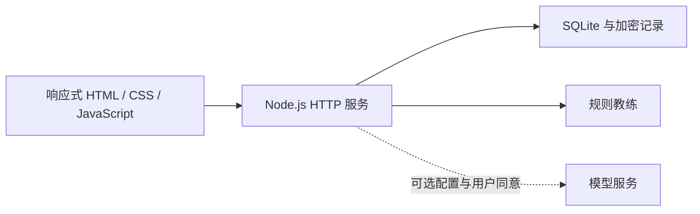

<p align="center"></p>

# FORMA · 女性塑形与健康习惯助手

**把运动、饮食和恢复拆成每天可以完成的小行动。**

[快速体验](#本地体验) · [功能与边界](#功能与边界) · [部署](docs/DEPLOYMENT.md) · [参与贡献](CONTRIBUTING.md) · [MIT](LICENSE)

FORMA 是面向成年女性的运动与健康习惯 Web 应用原型，包含响应式前端、账号系统、记录存储和可选 AI 教练接入。当前为 **Beta**，并非医疗产品，也不承诺塑形效果。

## 产品一览


<details><summary>查看移动端界面</summary>


</details>

*截图展示已有设计版本，具体界面以当前源码为准。*

## 功能与边界

| 模块 | 已有能力 |
| --- | --- |
| 每日行动 | 运动、饮食、恢复任务与完成记录 |
| 习惯记录 | 饮水、睡眠、训练感受与目标设置 |
| 个人空间 | 注册、登录、恢复码和账号删除 |
| 数据存储 | SQLite；记录载荷使用 AES-256-GCM 加密 |
| 教练对话 | 默认规则模式；配置服务端模型后可启用 AI |
| 自托管 | Docker Compose、Caddy HTTPS、定期备份 |

没有配置模型服务时，教练使用明确的规则模式。未接入可穿戴设备，也未实现真实健康监测。加密记录并不代表所有数据库字段均已加密；账号元数据仍需妥善保护。

## 本地体验

需要 **Node.js 24.x**，运行时使用 Node 内置模块，无需安装 npm 依赖。

```bash
git clone https://github.com/corrie0871-commits/forma.git
cd forma
node deploy/preview.mjs
```

打开 <http://127.0.0.1:8787>。预览使用内存数据库，停止进程后数据消失。请用虚构信息体验。

```bash
npm test
```

## 系统结构



```text
dist/          可直接运行的前端源码和静态资源
server/        API、账号、记录和备份服务
tests/         后端行为测试
deploy/        本地预览与自托管配置
compose.yaml   应用、HTTPS 代理和备份容器
```

## 自托管与数据

请阅读 [部署指南](docs/DEPLOYMENT.md) 和 [安全说明](SECURITY.md)。只提交 `.env.example`，不要提交真实 `.env`、数据库、备份或健康记录。正式使用前完善隐私页面中的运营方联系方式和实际数据处理说明。

## 下一步

- [ ] 更完整的无障碍与多设备验证
- [ ] 改进运动计划的可解释性与可调整性
- [ ] 建立经过评估的 AI 教练质量检查
- [ ] 完善运营方隐私信息和异地备份方案

## 许可与素材

项目原创代码和文档采用 [MIT](LICENSE) 许可。素材来源说明见 [ATTRIBUTION.md](ATTRIBUTION.md)。请勿使用真实用户健康数据提交 Issue 或演示。
